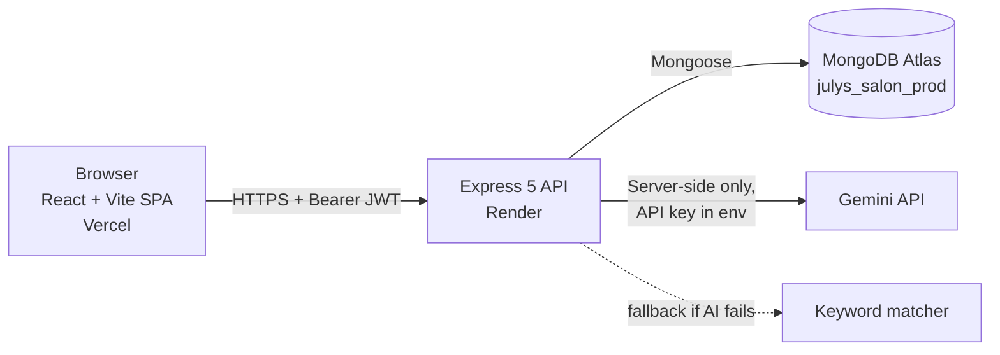
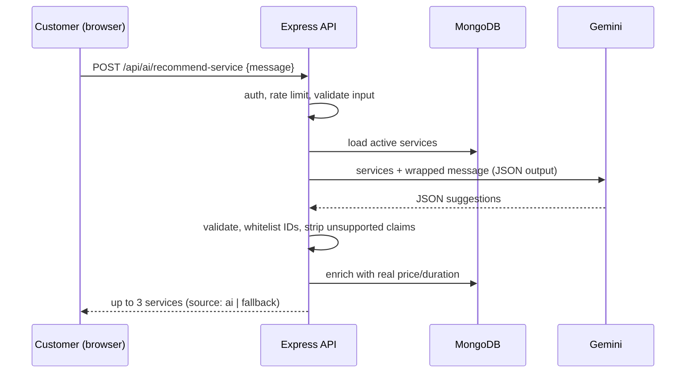
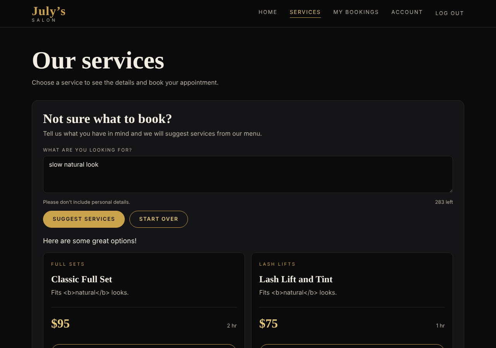
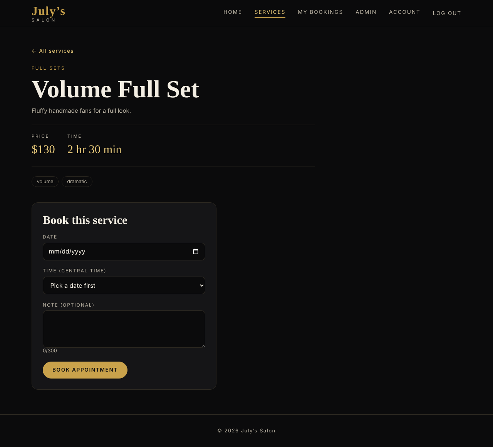
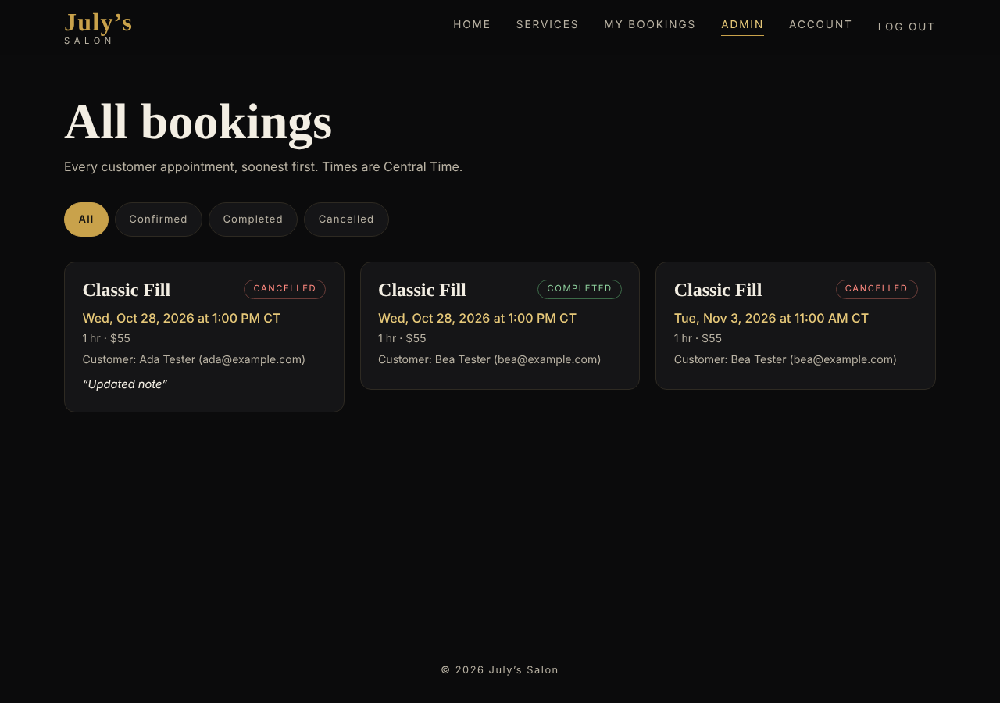
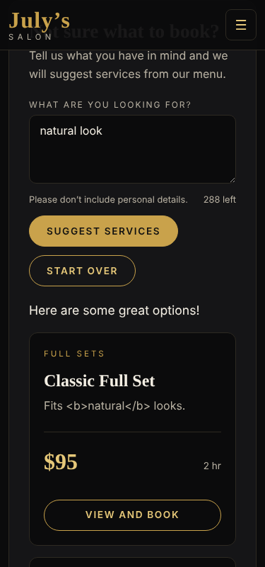

# July's Salon — Smart Appointment & Service Booking Platform

A full-stack booking platform for an eyelash salon, with an AI-assisted service recommender.
Customers browse services, get a recommendation, book a time slot, and manage their appointments. Admins see every booking and manage services.

| | |
|---|---|
| **Live app (frontend)** | https://julys-salon-booking.vercel.app |
| **Live API (backend)** | https://julys-salon-api.onrender.com |
| **Health check** | https://julys-salon-api.onrender.com/api/health |
| **Source code** | https://github.com/jasonharwell61/julys-salon-booking |

> **Heads-up:** the backend runs on Render's free tier and sleeps after 15 minutes idle. The first request after a pause can take about a minute. Open the health-check link first to wake it.

---

## 1. Overview and problem statement

Small appointment businesses often take bookings by text or DM. That causes double bookings, missed messages, and no clear record of who is coming when. Customers also struggle to pick between similar services (for example Classic vs. Volume vs. Hybrid lash sets).

July's Salon solves both:

- **Booking** — customers pick a service, date and time. The server enforces business hours, notice time and no-overlap rules, so a slot can't be double-booked.
- **Guidance** — a grounded AI assistant reads a customer's plain-English request ("a natural look for everyday wear") and suggests up to three services *from the salon's real service list*.

## 2. Target users

- **Customers** — book, view, reschedule, edit notes on, and cancel their own appointments.
- **Salon admin / owner** — view all bookings, filter by status, mark appointments completed, and manage the service catalog.

## 3. Key features

- Account registration and login (JWT)
- Role-based access: customer vs. admin
- Service catalog with categories, durations, prices and tags
- Booking with live availability on a 15-minute grid (Central Time)
- Server-enforced rules: Mon–Sat 9:00–18:00, 2-hour minimum notice, 90-day booking window, overlap → `409 Conflict`
- My Bookings: reschedule, edit note, cancel
- Admin: all-bookings view with status filters, mark completed, create/update/deactivate services
- **AI Lash Service Recommender** (see below)
- Responsive black-and-gold design (desktop and mobile)
- Loading, empty and error states throughout

## 4. AI feature: Lash Service Recommender

**What it does.** On the Services page, a logged-in customer describes what they want. `POST /api/ai/recommend-service` returns up to 3 matching services with a short reason for each.

**How it stays grounded and safe:**

1. The server loads the *active services from the database* and sends only their id, name, category, description, duration, price and tags to the model.
2. The customer's text is wrapped in `<customer_message>` tags with angle brackets neutralized, to resist prompt injection.
3. The model must return structured JSON. The server validates the shape, **whitelists service IDs** against the database, de-duplicates, caps at 3, and trims text.
4. Any reason or summary that makes unsupported claims (prices, guarantees, "safe", "hypoallergenic", medical claims, availability, discounts, "booked/confirmed") is replaced with safe text.
5. Prices, durations and names shown to the customer come **from the database, not from the AI**.
6. If the AI provider fails, times out (15 s) or returns bad output, the server falls back to a **keyword matcher** and still responds (`source: "fallback"`). The UI labels this.
7. Input is limited to 3–300 characters; emails and long digit runs are rejected so personal data isn't sent to the provider.
8. The endpoint requires login and is rate-limited per user (default 20 per 15 minutes).
9. Logs contain only safe fields (feature, source, outcome, latency, counts). Customer text is not logged or stored.
10. **The AI never creates, changes or cancels a booking.** It only suggests; the customer still books manually.

**Limitations.**

- It is a suggestion tool, not a consultation. It does not assess allergies, eye health or medical suitability.
- Quality depends on the model and on how well service descriptions are written.
- The free Gemini API tier may allow Google to use submitted content to improve its products — which is why personal data is blocked at input.
- A 19-case evaluation set is in [`docs/ai-evaluation-results.md`](docs/ai-evaluation-results.md).

## 5. Architecture



Request flow for an AI recommendation:



The API key never reaches the browser. All AI calls are made by the server.

## 6. Tech stack

| Layer | Technology |
|---|---|
| Frontend | React 19, Vite 8, react-router-dom 7, Bootstrap 5.3 + custom CSS, ESLint 10 |
| Backend | Node.js, Express 5, Mongoose 9 |
| Database | MongoDB Atlas (free tier) |
| Auth | JWT (HS256) in `Authorization: Bearer` header, bcryptjs password hashing |
| Security middleware | helmet, cors (single allowed origin), express-rate-limit, 10 kb JSON body limit, input validators |
| AI | Google Gemini via `@google/genai` (model set by `AI_MODEL`) |
| Hosting | Vercel (client), Render (server), Atlas (database) |

## 7. Folder structure

```
julys-salon-booking/
├── client/                  React + Vite app
│   ├── src/
│   │   ├── api/             API client and endpoint helpers
│   │   ├── components/      UI components (ServiceAdvisor, ProtectedRoute, ...)
│   │   ├── context/         AuthProvider
│   │   ├── hooks/           useAsyncData, useLogout
│   │   ├── pages/           Home, Services, ServiceDetail, MyBookings, Admin, Login, Register, Account
│   │   ├── utils/           salonTime and formatting helpers
│   │   └── assets/
│   └── vercel.json          SPA rewrite
├── server/                  Express API
│   ├── src/
│   │   ├── config/          env.js, bookingRules.js
│   │   ├── controllers/
│   │   ├── middleware/      auth, rate limiters, validation, error handler
│   │   ├── models/          User, Service, Booking
│   │   ├── routes/
│   │   ├── services/        bookingService.js, ai/ (provider, prompt, output checks, fallback)
│   │   ├── utils/
│   │   └── validators/
│   └── scripts/             tests, seed, AI evaluation, cleanup
├── docs/                    test plan, security review, deployment plan, AI evaluation, screenshots
└── README.md
```

## 8. Prerequisites

- Node.js **20.19 or newer, below 25** (developed on Node 24) and npm
- A free [MongoDB Atlas](https://www.mongodb.com/atlas) cluster and a database user
- A free [Google AI Studio](https://aistudio.google.com/) API key (only needed for live AI; without it the app uses the keyword fallback)
- Git

## 9. Installation

```powershell
git clone https://github.com/jasonharwell61/julys-salon-booking.git
cd julys-salon-booking

cd server
npm install
copy .env.example .env      # then edit .env with your own values

cd ..\client
npm install
copy .env.example .env      # if present; see client variable below
```

## 10. Environment variables (names only — never commit real values)

**Server (`server/.env`)** — see `server/.env.example`

| Variable | Purpose |
|---|---|
| `PORT` | API port (set by the host in production; 5000 locally) |
| `NODE_ENV` | `development` or `production` |
| `MONGODB_URI` | Atlas connection string (include the database name) |
| `JWT_SECRET` | Random secret, **32+ characters** |
| `JWT_EXPIRES_IN` | Token lifetime (e.g. `1d`) |
| `CLIENT_ORIGIN` | Exact frontend origin allowed by CORS, no trailing slash |
| `AI_PROVIDER` | AI provider name (`gemini`) |
| `AI_MODEL` | Model identifier |
| `AI_API_KEY` | Provider API key (server only) |
| `AI_TIMEOUT_MS` | AI call timeout (default 15000) |
| `AI_RATE_LIMIT_MAX` | AI requests per user per 15 min (default 20) |
| `TRUST_PROXY` | Number of proxy hops to trust (`0` locally, `1` on Render) |

**Client (`client/.env`)**

| Variable | Purpose |
|---|---|
| `VITE_API_BASE_URL` | Base URL of the API (e.g. `http://localhost:5000` locally) |

Generate a JWT secret:

```powershell
node -e "console.log(require('crypto').randomBytes(48).toString('hex'))"
```

## 11. Running locally

Use two terminals.

```powershell
# Terminal 1 - API
cd server
npm run dev

# Terminal 2 - frontend
cd client
npm run dev
```

Open http://localhost:5173. The API health check is http://localhost:5000/api/health.

## 12. Seeding the database

```powershell
cd server
npm run seed -- --confirm
```

The seed script refuses to run without `--confirm`, because it writes to whatever database `MONGODB_URI` points at. It loads 7 sample services.

To make an admin: register a normal account in the app, then change that user's `role` to `admin` in Atlas (Browse Collections → `users`).

## 13. API summary

| Method | Endpoint | Access | Purpose |
|---|---|---|---|
| GET | `/api/health` | Public | Server and database status |
| POST | `/api/auth/register` | Public | Create account |
| POST | `/api/auth/login` | Public | Log in, receive JWT |
| GET | `/api/auth/me` | User | Current user |
| GET | `/api/services` | Public | List active services (`?category=`) |
| GET | `/api/services/:id` | Public | One service |
| POST / PATCH / DELETE | `/api/services[/:id]` | Admin | Create / update / deactivate service |
| POST | `/api/bookings` | User | Create booking |
| GET | `/api/bookings/mine` | User | My bookings |
| GET / PATCH / DELETE | `/api/bookings/:id` | Owner (admin can view) | View / reschedule or edit note / cancel |
| GET | `/api/admin/services` | Admin | All services including inactive |
| GET | `/api/admin/bookings` | Admin | All bookings (filter by status) |
| POST | `/api/ai/recommend-service` | User | AI service recommendation |

Errors use one shape: `{ "error": "message", "details": [{ "field": "...", "message": "..." }] }`.

## 14. Testing

```powershell
cd server
npm test
```

Runs, with no real database or API key needed:

- booking rules (hours, notice, window, grid)
- ownership / authorization checks
- AI service (48 checks: validation, prompt injection, bad output, fallback, whitelist)
- AI route (16 checks)
- booking race condition (8 checks)

Other commands:

```powershell
npm run db:test      # check your MONGODB_URI connects
npm run ai:check     # check AI config (never prints the key)
npm run eval:ai      # run the 19-case AI evaluation (uses your real key; --dry-run to preview)
```

```powershell
cd client
npm run lint
npm run build
```

The full manual and automated plan (74 tests, mapped to requirements) is in [`docs/test-plan.md`](docs/test-plan.md). The security review is in [`docs/security-review.md`](docs/security-review.md).

## 15. Deployment overview

| Part | Host | Notes |
|---|---|---|
| Database | MongoDB Atlas | Database `julys_salon_prod`, dedicated least-privilege user (`readWrite` on that database only) |
| API | Render web service | Root dir `server`, build `npm install`, start `npm start`, health check `/api/health` |
| Frontend | Vercel | Root dir `client`, Vite preset, output `dist`, `VITE_API_BASE_URL` points at Render |

Set environment variables in each host's dashboard — never in the repository. `CLIENT_ORIGIN` on Render must exactly match the Vercel URL. Details: [`docs/deployment-plan.md`](docs/deployment-plan.md).

## 16. Screenshots

> These were captured from a **local test run with sample data** (prices and bookings differ from the live site). They show layout and behavior.

| Home (desktop) | Services with AI assistant (desktop) |
|---|---|
|  |  |

| Booking form (desktop) | Admin bookings (desktop) |
|---|---|
|  |  |

| Home (mobile) | AI recommendations (mobile) |
|---|---|
|  |  |

## 17. Known limitations

- **Free-tier hosting:** the API sleeps after 15 minutes idle (about a minute to wake).
- **Token storage:** the JWT is kept in `localStorage`. This is simple and works across hosts, but a cross-site scripting bug would expose it.
- **Logout** removes the token from the browser; a copied token stays valid until it expires (1 day). There is no server-side revocation list.
- **Booking lock is in-process:** the slot lock prevents double bookings within one server process. Running several server instances would need a database-level guard (for example a unique slot index or transactions).
- **Atlas network access is `0.0.0.0/0`** because Render's free tier has no fixed outbound IP. Access is still protected by a strong database password and a least-privilege user.
- **AI free tier:** submitted text may be used by the provider to improve products; the app blocks emails and long numbers to reduce risk.
- **No email/SMS confirmations or reminders, and no online payments.**
- **Single location and single staff calendar;** hours are fixed in code.
- Service Comparison Helper (a second AI feature) is not implemented.

## 18. Future improvements

- Email/SMS confirmation and reminders
- Payments or deposits to reduce no-shows
- Multiple staff members and per-staff availability
- Database-level double-booking guard for horizontal scaling
- HttpOnly-cookie sessions with refresh tokens and server-side revocation
- Admin-editable business hours and holidays
- Service Comparison Helper (grounded AI comparison of two services)
- Paid AI tier or self-hosted model for stricter data handling
- Browser end-to-end tests (Playwright) in CI

## 19. Responsible AI usage statement

- **Purpose and scope:** AI is used only to suggest services. It cannot book, cancel, price or promise anything.
- **Grounding:** suggestions are restricted to real services in the database; prices and durations come from the database.
- **Transparency:** the UI shows when results came from the fallback matcher instead of the AI.
- **Privacy:** no customer text is stored or logged; emails and long digit strings are rejected before reaching the provider; the API key stays on the server.
- **Safety:** unsupported claims (medical, safety, guarantee, discount, availability) are removed from AI text.
- **Human in control:** a customer must choose and confirm any booking themselves.
- **Evaluation:** behavior was tested against a fixed set of 19 cases including off-topic and prompt-injection inputs ([results](docs/ai-evaluation-results.md)).
- **Limits acknowledged:** the AI can still be wrong or generic; it is not professional advice.

### How AI assisted development

This project was built with Claude (Anthropic) acting as a coding mentor and reviewer, following a step-by-step plan. I ran, tested and committed the code myself, and used the guidance to understand design decisions (validation, authorization, rate limiting, grounding the AI). The app's runtime AI feature uses Google Gemini.

## 20. Author

**GitHub:** [jasonharwell61](https://github.com/jasonharwell61)  
<!-- Add your full name and LinkedIn here if you like -->
Capstone project, UT Arlington AI-Centric Software Engineering bootcamp (certification expected November 2026).

*July's Salon is the project's sample business; services and prices are illustrative.*
